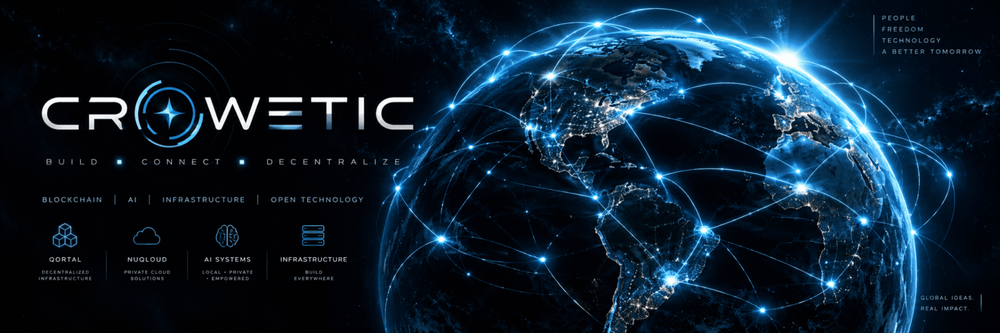
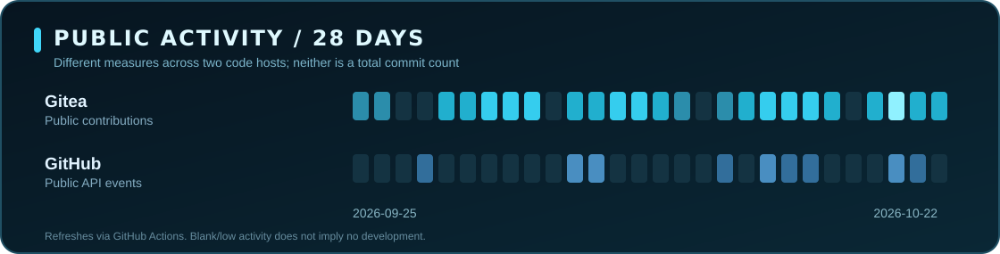

  

  <a href="https://crowetic.com"><strong>CHD</strong></a>
  &nbsp;&nbsp;·&nbsp;&nbsp;
  <a href="https://github.com/crowetic"><strong>GITHUB</strong></a>
  &nbsp;&nbsp;·&nbsp;&nbsp;
  <a href="https://gitea.qortal.link/crowetic"><strong>GITEA</strong></a>
  &nbsp;&nbsp;·&nbsp;&nbsp;
  <a href="https://qortal.org"><strong>QORTAL</strong></a>
   &nbsp;&nbsp;·&nbsp;&nbsp;
  <a href="https://nuqloud.com"><strong>NUQLOUD</strong></a>

<h3 align="center">Building Decentralized and Independent Infrastructure for the World.</h3>

  Qortal Founder · CHD · Full-stack and infrastructure engineer 
  Distributed networks / self-hosted cloud / local AI / agent orchestration

---

### 01 / What I'm building

| Network & distribution | Cloud & intelligence |
|:---|:---|
| **[Qortal](https://github.com/Qortal/qortal)**   A decentralized ecosystem for publishing, communications, and infrastructure beyond conventional hosting. | **[NuQloud AI](https://gitea.qortal.link/NuQloud-Public/nuqloud-ai)**   AI interfaces, tools, routing, and automation integrated with a self-hosted cloud platform. |
| **[Qortal External Auth](https://gitea.qortal.link/crowetic/Qortal-External-Auth)**   Using Qortal identity to authenticate external applications. | **[NuQloud Computer](https://gitea.qortal.link/NuQloud-Public/NuQloud-Computer)**   In development: connected computing environments for AI-assisted workflows. |
| **[QORTector Scripts](https://gitea.qortal.link/crowetic/QORTector-scripts)**   Automation and operations tooling for Qortal infrastructure. | **[NuQloud Appointments](https://gitea.qortal.link/NuQloud-Public/NuQloud-appointments)**   Custom scheduling and booking workflows for the NuQloud ecosystem. |

### 02 / The stack

`TypeScript` · `React` · `Java` · `Python` · `Bash` · `Linux` · `Docker` · `Proxmox` · `PostgreSQL` · `Qortal` · `Open WebUI` · `Local AI`

A lot of my engineering happens outside GitHub. The projects and activity below are pulled from both code forges rather than mirroring whole repositories just to create a contribution graph.

### 03 / Public engineering signal

  

<!-- CROWETIC:ACTIVITY:START -->
**Last fetched:** Gitea 2026-10-29 21:07 UTC · GitHub 2026-10-29 21:07 UTC

| Date (UTC) | Forge | Public activity | Repository |
|:---|:---|:---|:---|
| 2026-10-29 | **Gitea** | Pushed code | [NuQloud-Public/nuqloud-ai](https://gitea.qortal.link/NuQloud-Public/nuqloud-ai) |
| 2026-10-29 | **Gitea** | Pushed code | [NuQloud-Public/nuqloud-ai](https://gitea.qortal.link/NuQloud-Public/nuqloud-ai) |
| 2026-10-29 | **Gitea** | Pushed code | [NuQloud-Public/nuqloud-ai](https://gitea.qortal.link/NuQloud-Public/nuqloud-ai) |
| 2026-10-29 | **Gitea** | Pushed code | [NuQloud-Public/nuqloud-ai](https://gitea.qortal.link/NuQloud-Public/nuqloud-ai) |
| 2026-10-29 | **Gitea** | Pushed code | [NuQloud-Public/NuQloud-talk-federated-files](https://gitea.qortal.link/NuQloud-Public/NuQloud-talk-federated-files) |
| 2026-10-29 | **Gitea** | Pushed code | [NuQloud-Public/nuqloud-ai](https://gitea.qortal.link/NuQloud-Public/nuqloud-ai) |
| 2026-10-29 | **Gitea** | Pushed code | [crowetic/Q-Assets](https://gitea.qortal.link/crowetic/Q-Assets) |

Gitea includes public work in organizations such as NuQloud-Public. GitHub's public events endpoint covers recent activity (at most 30 days / 300 events). These are events, not an accurate cross-host commit count.
<!-- CROWETIC:ACTIVITY:END -->

### 04 / Engineering principles

- **Own your infrastructure.** Portability, self-hosting, and transparent system boundaries matter.
- **Design for failure.** Observability, recovery, security, and deployability are features.
- **Keep intelligence optional and composable.** Inference, orchestration, and APIs should be interchangeable.

  Built across <a href="https://github.com/crowetic">GitHub</a> and <a href="https://gitea.qortal.link/crowetic">Gitea</a>. Public activity snapshots refresh twice daily. Activity graphics are not GitHub's native contribution graph.

